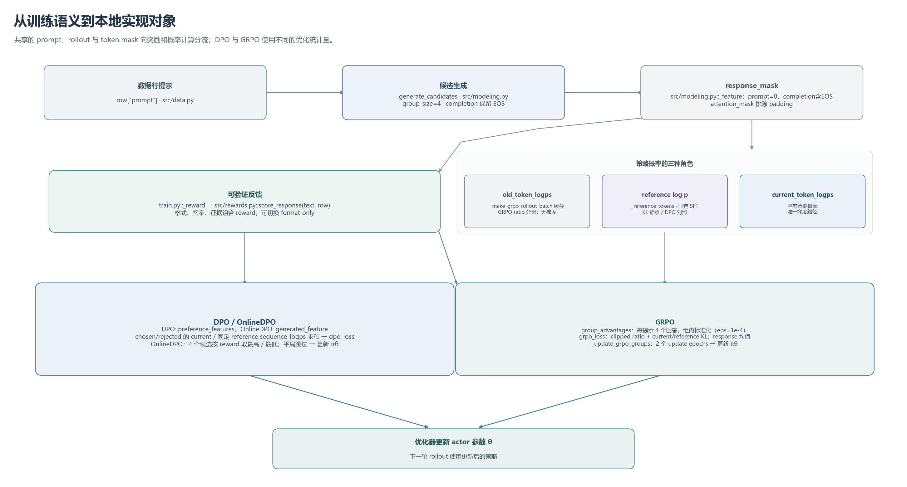

## 3 方法

### 3.1 任务定义与模型边界

本实验将输入 $x$ 定义为一段包含若干编号材料和问题的中文提示，模型输出 $y$ 为一个 JSON 对象，字段包括答案和证据材料编号。任务覆盖直接查找、两跳关系或数量合成、材料无法回答时拒答，以及依靠候选边界、唯一性和否定事实进行排除。目标不是开放领域问答，而是检验有限上下文中能否遵循格式、抽取答案、选择完整支持证据并在缺少关键事实时 abstain。由于模型是在虚构短材料上训练和评估，实验结论仅能描述该合成任务上的行为。

所有训练条件以 Qwen2.5-0.5B-Instruct 为共同起点，而非从随机初始化或未经指令调优的基座开始。它是一个已完成预训练和指令后训练的因果语言模型；本实验改变的是其低秩适配器参数，不能把所得差异解释为比较“预训练方法”或完整复现大规模 RLHF。未附加本次适配器的原始 Instruct checkpoint 是基线，SFT 后的适配器则是三类偏好优化方法共同的初始化。

### 3.2 因果语言模型与解码器结构

自回归语言模型把序列的联合概率分解为从左到右的条件概率。给定词元序列 $x_{1:T}$，模型按链式法则表示为

$$
p_\theta(x_{1:T})=\prod_{t=1}^{T}p_\theta(x_t\mid x_{<t}), \qquad
\mathcal{L}_{\mathrm{pretrain}}(\theta)=-\sum_{t=1}^{T}\log p_\theta(x_t\mid x_{<t}).
$$

因果注意力屏蔽未来位置，使位置 $t$ 的表示只依赖 $x_{\leq t}$。大规模预训练通过下一词元预测学习通用语言分布；指令微调和偏好优化则在已有分布上改变特定输入下不同回答的相对概率。GPT-3 的自回归建模和 InstructGPT 的“示范监督后接偏好优化”分别展示了这两层目标的差异 [E1, E2]。

本实验固定模型为 Qwen2ForCausalLM 架构的 Qwen2.5-0.5B-Instruct。锁定的模型配置给出 24 个解码层、隐藏维度 896、前馈维度 4864、14 个查询头和 2 个键值头，每头维度为 64；词表为 151,936，输入上下文配置上限为 32,768 词元，输入与输出嵌入权重共享 [E3, E4]。Qwen2.5 报告将该系列描述为采用预归一化的 Transformer 解码器，并列出分组查询注意力（GQA）、旋转位置嵌入（RoPE）、RMSNorm 和 SwiGLU 等组成 [E3]。GQA 让多个查询头复用较少的键值头；此处每 7 个查询头对应 1 个键值头，可减少键值表示和缓存开销。

对每层输入隐状态 $H\in\mathbb{R}^{n\times d}$，先由线性投影得到查询、键和值。RoPE 将位置相关的旋转施加于查询和键；因果注意力再以未来位置掩码限制可见范围：

$$
\operatorname{Attn}(Q,K,V)=\operatorname{softmax}\!\left(\frac{QK^{\mathsf T}}{\sqrt{d_h}}+M\right)V,
$$

其中 $d_h=64$，$M_{ij}=0$（当 $j\le i$），而 $M_{ij}=-\infty$（当 $j>i$）。GQA 的多组查询头共享键和值头，输出再经注意力输出投影。预归一化残差块可概括为

$$
\begin{aligned}
\widetilde H^{(\ell)}&=H^{(\ell-1)}+\operatorname{GQA}(\operatorname{RMSNorm}(H^{(\ell-1)})),\\
H^{(\ell)}&=\widetilde H^{(\ell)}+\operatorname{SwiGLUFFN}(\operatorname{RMSNorm}(\widetilde H^{(\ell)})).
\end{aligned}
$$

RMSNorm 按均方根对各词元的特征向量归一化，再施加可学习缩放；SwiGLU 前馈层使用门控的 SiLU 非线性，可写作 $W_{down}(\operatorname{SiLU}(W_{gate}h)\odot W_{up}h)$。因此，注意力负责按内容路由上下文信息，前馈子层则对每个位置独立进行非线性变换。上述结构解释模型如何产生条件分布，但本实验并不更新这些主体权重。

### 3.3 低秩适配

LoRA 将预训练矩阵 $W_0$ 冻结，并以低秩矩阵乘积表示任务增量：

$$
W=W_0+\Delta W,\qquad \Delta W=\frac{\alpha}{r}BA,
$$

其中 $A\in\mathbb{R}^{r\times d_{in}}$、$B\in\mathbb{R}^{d_{out}\times r}$，且 $r\ll\min(d_{in},d_{out})$。它在保持基础权重不变的条件下减少可训练参数量 [E5]。实际适配器设置为 $r=8,\alpha=16$，只挂接到每层的 q_proj 和 v_proj，dropout 为 0，不训练偏置；因此缩放系数为 $\alpha/r=2$。主模型以 BF16 加载，使用 PyTorch SDPA、关闭训练期 KV cache，并启用梯度检查点；优化器只接收当前可训练适配器参数 [src/modeling.py]。

输入经 tokenizer 的聊天模板编码，附加 generation prompt。提示超过长度上限时程序报错而不截断问题或材料。当前数据提示在该固定 tokenizer 和聊天模板下最多为 182 个词元，配置上限为 256；监督完成长度上限为 64 个词元且包括 EOS。训练特征把提示位置的标签设为 -100，仅完成文本和 EOS 参与损失计算 [docs/DATA.md, src/modeling.py]。

### 3.4 监督微调

监督微调（SFT）要求模型在材料提示之后生成标准答案 JSON。对目标完成序列 $y_{1:m}$，其条件负对数似然为

$$
\mathcal{L}_{\mathrm{SFT}}(\theta)=-\sum_{t=1}^{m}\log\pi_\theta(y_t\mid x,y_{<t}).
$$

训练时对 logits 与标签作一位移位，使每个位置预测下一个词元；提示标签与补齐标签均忽略，答案结束标记 EOS 保留在监督目标内。损失按有效词元平均，由 AdamW 更新 LoRA 参数；实现中权重衰减为 0、梯度范数裁剪上限为 1.0。SFT 只学习从单一 gold 输出模仿答案结构及其内容，尚不直接利用同一提示下多个回答之间的相对质量信息。此处使用 512 条独立 SFT 提示，配置为每批 1 条、梯度累积 1、100 次优化器更新、学习率 $2\times10^{-4}$；训练提示通过带种子的随机抽样而非无放回 epoch 遍历，因此更新次数不等于完整数据集轮数 [src/train.py, configs/experiment.json]。

### 3.5 离线 DPO

直接偏好优化（DPO）以同一提示 $x$ 下的较优回答 $y_w$ 和较差回答 $y_l$ 构造二元偏好。其推导将 KL 约束奖励最大化问题中的最优策略重新参数化为相对于参考策略的对数概率比，从而直接优化偏好分类似然，而无须显式拟合独立奖励模型 [E6]：

$$
\begin{aligned}
\Delta_\theta(x,y)&=\log\frac{\pi_\theta(y\mid x)}{\pi_{ref}(y\mid x)},\\
\mathcal{L}_{\mathrm{DPO}}(\theta)&=-\mathbb{E}_{(x,y_w,y_l)}
\log\sigma\!\left(\beta\left[\Delta_\theta(x,y_w)-\Delta_\theta(x,y_l)\right]\right).
\end{aligned}
$$

其中 $\beta$ 控制偏好优势的尺度以及相对参考策略偏移的强弱。代码分别计算响应序列的逐词元对数概率并求和，再代入上述 logistic loss；EOS 计入序列概率，提示词元与 padding 不计入。训练策略 $\pi_\theta$ 从 SFT 适配器继续优化；$\pi_{ref}$ 是加载在同一冻结基座上的 SFT 适配器副本，保持不变。这里“参考策略”是在初始化与数据设计中的固定对照，不是 ORPO/SimPO 一类无显式参考概率项损失所必然要求的数学项。该实现不训练奖励模型，也不在训练循环中生成回答。

本地偏好对来自 256 条独立提示，由规则生成器把 gold JSON 设为 chosen，并按预定错误类型构造 rejected：答案错误、证据错误、无依据猜答或过度拒答；不可回答样例不把正确拒答误作负例。标签因此是合成规则偏好而非人工偏好。当前参数为 $\beta=0.1$、学习率 $5\times10^{-5}$、批量 1、累积 1、100 次优化器更新；提示对和拒答构造过程均不使用验证或测试样例 [docs/DATA.md, src/data.py, src/train.py]。

### 3.6 在线偏好优化

离线 DPO 的偏好对在策略训练之前已固定；在线 DPO 则在当前策略上为训练提示采样若干回答，根据奖励实时组成偏好对，再用 DPO 更新策略。本文的“在线 DPO”是项目内的具体实现名称，不声称与某一篇文献中的算法变体完全等同。每个提示由当前策略独立采样 $G=4$ 个完成，采样使用温度 1、top-p 1、top-k 0，即不通过 top-p/top-k 截断候选支持集；每个回答由完整格式、答案和证据奖励评分。若组内奖励并列，跳过该提示；否则从最高奖励候选中随机选择 chosen，并从最低奖励候选中随机选择 rejected，然后相对固定 SFT reference 计算 DPO 损失。下一轮提示由已更新的当前策略重新采样，故偏好样本分布随策略变化，而训练信号仍来自可程序判定的奖励，不来自人类标注。

在线 DPO 配置为学习率 $5\times10^{-5}$、梯度累积 2、最多采样 128 个提示组、最多 64 次有效更新。提示组遇到并列时照样消耗 rollout 预算但不产生优化更新；因此 64 是更新上限，而非保证达到的步数。该设计在生成预算上可与 GRPO 同设 128 个提示、每提示四个候选，但它与 GRPO 的优化器更新数、复用方式和梯度轨迹不同，不能据此称为总算力严格匹配的比较 [src/modeling.py, src/train.py, configs/experiment.json]。

### 3.7 GRPO

群组相对策略优化（GRPO）对同一提示生成 $G$ 个回答，按组内奖励构造相对优势，以避免单独训练价值函数；DeepSeekMath 将其作为 PPO 的一种变体用于数学推理 [E7]。本文实现先在组内对标量奖励 $r_i$ 做均值中心化和总体标准差归一化：

$$
\begin{aligned}
A_i&=\frac{r_i-\mu_r}{\sigma_r+\epsilon},\\
\mu_r&=\frac{1}{G}\sum_{j=1}^{G}r_j,\\
\sigma_r&=\sqrt{\frac{1}{G}\sum_{j=1}^{G}(r_j-\mu_r)^2}.
\end{aligned}
$$

总体标准差对应代码中 unbiased=False，$\epsilon=10^{-4}$ 防止除零。对 rollout 时策略 $\pi_{old}$ 与更新策略 $\pi_\theta$ 的每个完成词元，令比率 $\rho_{it}=\exp(\log\pi_\theta-\log\pi_{old})$。损失包括 PPO 式截断代理目标和对固定 SFT reference 的采样 KL 估计：

$$
\begin{aligned}
\mathcal{L}_{\mathrm{GRPO}}=&-\frac{1}{N}\sum_{i=1}^{N}\frac{1}{|o_i|}\sum_t m_{it}\\
&\quad\cdot\min\!\left(\rho_{it}A_i,\operatorname{clip}(\rho_{it},1-\varepsilon_c,1+\varepsilon_c)A_i\right)\\
&+\beta\frac{1}{N}\sum_{i=1}^{N}\frac{1}{|o_i|}\sum_t m_{it}
\left[e^{\delta_{it}}-\delta_{it}-1\right],\\
\delta_{it}=&\log\pi_{ref}(o_{it}\mid x_i,o_{i,<t})-\log\pi_\theta(o_{it}\mid x_i,o_{i,<t}).
\end{aligned}
$$

其中 $m_{it}$ 仅选择完成词元并包括 EOS，$|o_i|$ 是有效回答长度。实现先对每条回答内部的有效词元平均，再对回答平均；优势在一个提示的四个回答间共享各自的标量值。old 与 reference 对数概率在一次 rollout 后无梯度缓存；GRPO 对缓存的同组样本执行两次更新，再重新采样。组内奖励相同会令优势为零，此时策略梯度项消失，但 KL 项仍在；与在线 DPO 的并列组跳过规则不同。

当前 GRPO 配置为 $G=4$、$\varepsilon_c=0.2$、$\beta=0.02$、$\epsilon=10^{-4}$，学习率 $10^{-5}$，梯度累积 2，128 次优化器更新，rollout 样本复用 2 个更新轮次。每次新 rollout 批次取 2 个提示，因此 128 次更新对应 64 批、共 128 个提示组；每组生成 4 个回答。为适应显存，采样似然与每个回答的更新前向均逐条计算；这一实现选择影响吞吐量，但不改变组内相对奖励目标 [src/modeling.py, src/train.py, configs/experiment.json]。

### 3.8 从训练目标到本地更新接口

理论目标需经过数据和张量接口才能形成实际参数更新。规则生成器输出的每行记录包含模型提示、标准答案及审计用元数据；训练输入只取提示和目标文本。提示先经过固定 tokenizer 的聊天模板，特征构造再将 prompt 词元标签屏蔽、将回答与 EOS 设为有效响应词元。因而，NLL、偏好似然和强化学习损失实际作用于同一回答区间，padding、提示及 EOS 后词元不参与评分或梯度 [src/data.py, src/modeling.py]。

离线 DPO 从静态 chosen/rejected 字段构造成成对特征，并分别计算当前策略和冻结 SFT reference 的回答序列 log-prob 总和；在线 DPO 则从当前 policy rollout 得到 4 个候选，先由奖励函数给分，再以最高/最低得分候选构造成对特征。GRPO 对同组候选分别保存 rollout 时 old-policy 与固定 reference 的逐词元概率，按奖励计算组内优势；更新时重新计算 current-policy log-prob，结合有效 response mask 计算截断目标与 KL 项，并按每条回答的有效长度平均、再对回答求均值。SFT 只使用当前 LoRA 参数进行优化；三种偏好/强化学习训练都以 SFT 适配器初始化可训练 policy，同时冻结 reference。图 3 汇总本项目从 prompt、候选、响应掩码及奖励到不同概率张量和优化器更新的局部实现路径；图中函数名仅对应本地代码 [src/modeling.py, src/rewards.py, src/train.py]。

*图 3  本地实验实现中 prompt、rollout、response mask、奖励、old/reference/current log-prob 与 DPO/GRPO 更新之间的关系。该图描述本项目代码，不能据此推断其他框架具有相同代码路径。*

### 3.9 奖励定义与评价指标

奖励将生成格式、答案和证据联合纳入可验证标量。有效输出必须是恰含 answer 与 evidence 两个字段的 JSON 对象，答案非空，证据是无重复正整数编号；空白和键顺序不影响合法性，代码围栏、对象外文本、重复键、额外字段、错误类型及超出材料范围的编号均使格式判定失败。证据精确度按去重后的编号集合与 gold 集合比较，不受列举顺序影响。

$$
R=0.10I_{format}+0.45I_{answer}+0.45I_{answer\land evidence\_exact}.
$$

因此格式正确但答案错误得 0.10；答案正确而证据不精确得 0.55；答案与证据均精确且格式合法得 1.00。该设计不按部分证据 F1 给训练奖励，避免模型通过多列材料连续获得部分回报；证据 F1 保留为诊断指标。格式消融使用独立的二元奖励，仅在 JSON/schema 合法时为 1，不读取 gold 答案、材料范围或证据正确性。因此它可检验格式反馈是否改变输出规范性，却不能代表完整任务奖励，也不提供事实正确性信号 [docs/DATA.md, src/rewards.py]。

贪心解码固定用于评估，最多生成 64 个新词元。逐样本记录格式合法、答案正确、证据 exact、证据 F1、答案—证据联合正确及适用时的正确拒答；摘要均值当前覆盖前五项，正确拒答率可由不可回答样本的逐样本记录另行分层统计。总体指标按测试集样本数计算，同时按 lookup、two_hop、unanswerable、negation 分层，以免总体均值掩盖任务构成差异。反事实测试另应按 80 对检查两侧是否均答对，以及答案是否随唯一事实变化；这一成对分析与逐样本准确率不同，可识别模型是否在反事实变化下仍复制旧答案。

## 4 实验设计

### 4.1 数据与划分

数据完全由固定种子的规则生成器构造，不含真实语料、外部检索结果或人工标注。生成器先建立虚构事实，再把事实写成 4—6 条编号材料；保留在 metadata 中的潜在关系图只用于复算标签与审计，不输入模型。四类任务在每个问答划分中等量，two_hop 的关系链与加法子任务也等量。SFT 与偏好提示分离，验证和测试提示不用于生成训练偏好。数据规模与用途见表 1。

| 划分 | 样本数 | 作用 |
|---|---:|---|
| SFT 训练提示 | 512 | 标准 JSON 答案监督 |
| 偏好训练提示 | 256 | 固定偏好对及在线采样提示池 |
| 验证集 | 96 | 训练方案与超参数选择，不用于最终测试结论 |
| ID 测试集 | 160 | 与训练相同词表和模板机制下的最终评估 |
| OOD 测试集 | 160 | 留出实体词表及问句措辞，逻辑结构保持不变 |
| 反事实测试 | 160（80 对） | 每对仅改一个事实，检查答案是否随事实变化 |

否定任务的候选名单只界定候选范围，本身不蕴含候选中确有人持有目标物；“仅一人保管”的独立事实与两条候选否定事实共同决定唯一剩余者。因此四条材料均为必要证据。反事实测试中，否定关系替换、属性变化、第二跳位置或数量变化、以及补入原本缺失关系均改变目标答案。OOD 仅测词汇与模板迁移，不等同于新的推理结构；有限模板还留下利用格式线索的可能性。故对该数据的表现不外推为真实文档问答或开放领域鲁棒性 [docs/DATA.md]。

### 4.2 对照方法

表 2 总结方法的初始化、监督信号与样本生成机制。各条件的差异不只是优化器：离线 DPO 使用预先构造的规则偏好；在线 DPO 与 GRPO 用生成样本和规则奖励；格式消融只使用格式判断；SFT 则直接模仿唯一标准答案。

| 条件 | 初始化与训练信号 | 主要差异 |
|---|---|---|
| Instruct 基线 | 原始 Qwen2.5-0.5B-Instruct，无本次适配器 | 衡量已有指令模型在合成任务上的零次适配表现 |
| SFT | Instruct + LoRA；512 个 prompt/gold completion | 仅以 gold 答案完成序列的 token NLL 训练 |
| 离线 DPO | SFT 初始化；256 条自动构造 chosen/rejected 对 | 偏好样本固定，训练时不重新生成回答 |
| 在线 DPO | SFT 初始化；当前策略生成 $G=4$ 个回答后选最高/最低奖励对 | 每次更新都可依赖新策略的分布；并列组跳过 |
| GRPO | SFT 初始化；同一提示生成 $G=4$ 个回答 | 组相对优势、截断策略目标与 reference KL；rollout 复用两轮 |
| 格式奖励 GRPO 消融 | 与 GRPO 相同模型路径，奖励仅检查 JSON/schema | 隔离“格式可验证性”信号，不反馈答案和证据正确性 |

所有适配条件使用相同的任务目标和贪心评估协议，但其监督信息与候选生成开销不相同。离线 DPO 与 SFT 依赖预制监督样本；在线方法额外消耗生成与奖励计算；GRPO 对采样组进行多轮更新。故表中比较用于分析不同后训练信号在同一有限任务上的表现，不构成等 FLOPs 或等墙钟时间的算法排行榜。若据此比较收益，应连同更新步数、采样回答数、生成词元数及显存、耗时日志一并解释。

### 4.3 训练设置与复现口径

当前配置以随机种子 20261028 固定数据生成和单次运行默认值；两种训练随机种子的重复运行是拟议汇总方案，第二种子需通过命令行覆写，不能把当前配置文件误读为已完成了双种子运行。每个方法以 SFT 适配器为起点（Instruct 基线除外），设置 BF16、LoRA $r=8,\alpha=16$、q/v 投影目标、AdamW、零权重衰减、梯度范数裁剪 1.0；训练批量 1，长度限值为 prompt 256、completion 64。除在线 DPO 和 GRPO 的累积步数为 2 外，其余默认累积 1。表 3 列出训练计划参数。

| 方法 | 更新步数上限 | 学习率 | 偏好/奖励参数 | 数据或 rollout 预算 |
|---|---:|---:|---|---|
| SFT | 100 | $2\times10^{-4}$ | token NLL | 512 条样本池，按种子有放回抽样 |
| 离线 DPO | 100 | $5\times10^{-5}$ | $\beta=0.1$ | 256 条固定偏好对 |
| 在线 DPO | 64 | $5\times10^{-5}$ | $\beta=0.1,G=4$ | 最多 128 提示组；并列组消耗预算但不更新 |
| GRPO | 128 | $1\times10^{-5}$ | $G=4,\varepsilon_c=0.2,\beta=0.02,\epsilon=10^{-4}$ | 128 个提示组；每组更新复用 2 次 |
| 格式奖励 GRPO | 与 GRPO 相同的拟议计划 | 同 GRPO | 仅 $I_{format}$ | 同 GRPO |

更新次数表示优化器更新上限，不是数据集 epoch 数。对 GRPO，批量 1 与梯度累积 2 使每次更新对应两个提示组；每批新采样组供两个连续更新复用，所以 128 次更新产生 64 个 rollout 批次、合计 128 个提示组。在线 DPO 每次更新最多纳入两个提示组，达到 128 组预算时最多进行 64 次更新；若奖励全并列，有效更新会少于上限。由此可说两种在线算法采用相同的提示组预算，但不能说生成、反向传播、更新次数或总计算量完全相同。

验证集在设计上用于确定学习率、停止点等配置，测试集只在最终评估时使用。不过当前训练器不在训练过程中调用验证评估，也只保存最终适配器；若需要验证集模型选择，须通过单独的 evaluate 调用在训练前或完成训练后进行，不能声称存在自动按验证指标保存最优 checkpoint 的机制 [src/train.py]。

### 4.4 评估程序与统计

基线和各方法均对 ID、OOD 与反事实测试集作确定性贪心解码，并保留逐样本预测及打分。主要结果以准确率、证据精确率和联合正确率等比例报告，辅以证据 F1；分母为相应评估子集样本数。答案与证据必须同时正确才计为 joint correct。不可回答问题另报告正确拒答，避免总体答案准确率把“未知”与有内容回答混为一谈。按四类任务分层的比例揭示总体平均是否仅由简单 lookup 主导；反事实集按配对单位报告双侧正确与答案翻转一致性，不能将 160 条记录当作 160 个独立反事实对。

计划使用两个训练随机种子，并在固定数据划分上分别运行。汇总表报告种子间均值与标准差，同时逐样本配对比较相同提示上的方法差异；反事实分析按 pair_id 配对。每项分数需同时报告样本数和评价解码条件，避免把合成数据上的低方差估计解读为普遍性能保证。在线方法的过程日志还记录 rollout 数、生成词元数、奖励、梯度更新和显存峰值及耗时，可用于解释效果—计算折衷；在最终实验运行完成前，这些量只属于记录设计，不作结果陈述。

## 本节参考文献

[E1] Brown, T. B., et al. (2020). “Language Models are Few-Shot Learners.” arXiv:2005.14165. https://arxiv.org/abs/2005.14165

[E2] Ouyang, L., et al. (2022). “Training language models to follow instructions with human feedback.” arXiv:2203.02155. https://arxiv.org/abs/2203.02155

[E3] Qwen Team, Yang, A., et al. (2024; revised 2025). “Qwen2.5 Technical Report.” arXiv:2412.15115v2. https://arxiv.org/abs/2412.15115

[E4] Qwen Team. (2024). “Qwen2.5-0.5B-Instruct model configuration,” pinned revision 7ae557604adf67be50417f59c2c2f167def9a775. https://huggingface.co/Qwen/Qwen2.5-0.5B-Instruct/blob/7ae557604adf67be50417f59c2c2f167def9a775/config.json

[E5] Hu, E. J., et al. (2021). “LoRA: Low-Rank Adaptation of Large Language Models.” arXiv:2106.09685v2. https://arxiv.org/abs/2106.09685

[E6] Rafailov, R., et al. (2023; revised 2024). “Direct Preference Optimization: Your Language Model is Secretly a Reward Model.” arXiv:2305.18290v3. https://arxiv.org/abs/2305.18290

[E7] Shao, Z., et al. (2024). “DeepSeekMath: Pushing the Limits of Mathematical Reasoning in Open Language Models.” arXiv:2402.03300v3. https://arxiv.org/abs/2402.03300
